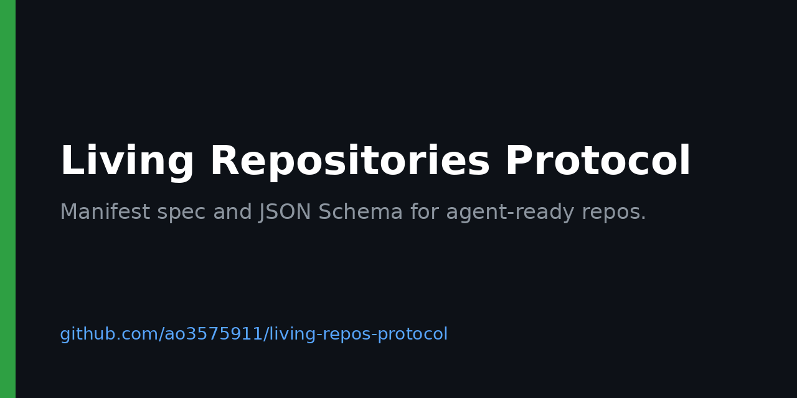

# Living Repositories Protocol
Canonical protocol/specification repository for Living Repositories.

A manifest that declares what a repository's cloud agent may do, how it is isolated and where it reports state, with a schema and a validator to enforce it.
Initial target: `v0.1.0-draft`

<!-- BEGIN GENERATED: badges -->

[](https://github.com/ao3575911/living-repos-protocol/actions/workflows/ci.yml) [](https://github.com/ao3575911/living-repos-protocol/releases) [](LICENSE)

<!-- END GENERATED: badges -->



## What it is

The specification for Living Repositories: repositories that bring their own cloud agent runtime. It defines the `.living/manifest.yaml` format and publishes a JSON Schema for it.

## Quickstart

Validate a manifest against the schema:

```sh
git clone https://github.com/ao3575911/living-repos-protocol
cd living-repos-protocol
pip install -r requirements-ci.txt
python scripts/validate.py examples/manifest.yaml           # lenient
python scripts/validate.py --strict examples/manifest.yaml  # every spec rule
```

## Manifest fields

<!-- BEGIN GENERATED: fields -->

| Field | Type | Required | Allowed | Description |
| --- | --- | --- | --- | --- |
| `protocol_version` | string | yes | pattern `^v\d+\.\d+\.\d+(-[0-9A-Za-z.-]+)?$` | Protocol version the manifest targets: v followed by SemVer, for example v0.1.0-draft. |
| `project_id` | string | yes | pattern `^[a-z0-9][a-z0-9-]{0,62}$` | Stable repository identifier: lowercase letters, digits and hyphens, at most 63 characters. |
| `agent_capabilities` | array of strings | yes | `run_tasks`, `publish_state`, `open_pull_requests`, `snapshot_restore`, `handoff`, `read_secrets` | What the agent may do. A runtime must refuse to start an agent that declares a capability it does not support. |
| `isolation_profile` | string | yes | `dedicated-vm`, `container`, `sandbox-process` | How the runtime isolates the agent. |
| `state_publication` | object | yes | - | Where the agent publishes its state. |
| `state_publication.target` | string | yes | `control-process`, `file`, `webhook` | control-process, file or webhook. |
| `state_publication.path` | string | no | - | State file path relative to the repository root. Required when target is file. |
| `state_publication.url` | string | no | pattern `^https://` | https URL that receives state. Required when target is webhook. |
| `logging_requirements` | object | yes | - | How the agent logs. |
| `logging_requirements.structured` | boolean | yes | - | true means one JSON object per log line. |
| `logging_requirements.level` | string | no | `debug`, `info`, `warn`, `error` | Minimum log level. Default info. |
| `snapshot` | object | no | - | What the runtime snapshots and how long it keeps snapshots. Used with the snapshot_restore capability. Optional. |
| `snapshot.paths` | array of strings | yes | - | Paths relative to the repository root to include in each snapshot. |
| `snapshot.retention_days` | integer | no | - | Days to keep each snapshot. Default 7. |
| `secrets` | array of strings | no | - | Names of the secrets the agent needs, never their values. Requires the read_secrets capability. Optional. |

Generated from [`schemas/manifest.schema.json`](schemas/manifest.schema.json) by `scripts/gen_readme.py`. Top-level keys starting with `x-` are allowed as extensions.

<!-- END GENERATED: fields -->

## GitHub Action

Validate a repository's manifest in CI:

```yaml
- uses: actions/checkout@v7.0.1
- uses: ao3575911/living-repos-protocol@v0.4.0
  with:
    manifests: .living/manifest.yaml
```

`manifests` takes space-separated paths or glob patterns. By default the job fails only on manifests that break the v0.1.0 rules; unknown fields and values outside the allowed sets are warnings. Set `strict: "true"` to fail on those as well.

## Docs

Docs site: [https://ao3575911.github.io/living-repos-protocol/](https://ao3575911.github.io/living-repos-protocol/)

- [Strategy](STRATEGY.md): problem, audience, non-goals and alternatives

- [Specification](docs/spec.md)
- [Protocol PRD](docs/protocol-prd.md)
- [Versioning](docs/versioning.md)
- [Runtime capability document](docs/runtime.md)
- [Manifest schema](schemas/manifest.schema.json)
- [Runtime document schema](schemas/runtime.schema.json)

## Status

Draft. Protocol version `v0.4.0`; repository release v0.4.0. Runtimes declare what they support in a runtime capability document. Strict mode enforces every rule in the spec; the default lenient mode accepts every manifest valid under v0.1.0. `tests/` holds the conformance fixtures.

## Related

- [living-repos](https://github.com/ao3575911/living-repos): examples and demos that implement this protocol.

## Licence

[MIT](LICENSE). See [CONTRIBUTING.md](CONTRIBUTING.md) to contribute.
